<!-- Généré par tools/build.mjs : modifier tools/src/content.mjs, puis « npm run build » dans tools/. -->

  

  <a href="https://charles-lindecker.com"><picture><source media="(max-width: 700px)" srcset="./assets/fr/hero.mobile.svg"></picture></a>

  &nbsp;
  &nbsp;
  

  <a href="https://www.linkedin.com/in/charles-lindecker/"><picture><source media="(max-width: 700px)" srcset="./assets/fr/hunter.mobile.svg"></picture></a>

  <a href="https://charles-lindecker.com"><picture><source media="(max-width: 700px)" srcset="./assets/fr/rules.mobile.svg"></picture></a>

  <a href="https://charles-lindecker.com"><picture><source media="(max-width: 700px)" srcset="./assets/fr/sky.mobile.svg"></picture></a>

  <a href="https://bloodborne-legendary-run.com/fr/sky"><picture><source media="(max-width: 700px)" srcset="./assets/fr/flagship.mobile.svg"></picture></a>

  &nbsp;
  

  <picture><source media="(max-width: 700px)" srcset="./assets/fr/sep-equipe.mobile.svg"></picture>

  <a href="https://github.com/Teyliu/PVZF-Translation"><picture><source media="(max-width: 700px)" srcset="./assets/fr/card-pvz.mobile.svg"></picture></a>

  &nbsp;
  

  <picture><source media="(max-width: 700px)" srcset="./assets/fr/sep-jeu.mobile.svg"></picture>

  <a href="https://github.com/LINDECKER-Charles/public-Omnicard/blob/main/docs/rules.md"><picture><source media="(max-width: 700px)" srcset="./assets/fr/card-omnicard.mobile.svg"></picture></a>

  

  <a href="https://league-of-data-base.com/fr/"><picture><source media="(max-width: 700px)" srcset="./assets/fr/card-league.mobile.svg"></picture></a>

  &nbsp;
  <a href="https://github.com/LINDECKER-Charles/LeagueOfDataBaseFinal">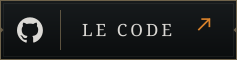</a>

  <picture><source media="(max-width: 700px)" srcset="./assets/fr/sep-outils.mobile.svg"></picture>

  <a href="https://github.com/LINDECKER-Charles/gup"><picture><source media="(max-width: 700px)" srcset="./assets/fr/card-gup.mobile.svg"></picture></a>

  &nbsp;
  &nbsp;
  

  <a href="https://github.com/LINDECKER-Charles/App.GitHealth"><picture><source media="(max-width: 700px)" srcset="./assets/fr/card-githealth.mobile.svg"></picture></a>

  

  <picture><source media="(max-width: 700px)" srcset="./assets/fr/sep-ia.mobile.svg"></picture>

  <a href="https://charles-lindecker.com"><picture><source media="(max-width: 700px)" srcset="./assets/fr/card-karl.mobile.svg"></picture></a>

  <a href="https://charles-lindecker.com"><picture><source media="(max-width: 700px)" srcset="./assets/fr/card-sillage.mobile.svg"></picture></a>

  <a href="https://charles-lindecker.com"><picture><source media="(max-width: 700px)" srcset="./assets/fr/card-relais.mobile.svg"></picture></a>

  <picture><source media="(max-width: 700px)" srcset="./assets/fr/note-releve.mobile.svg"></picture>

  <a href="https://www.linkedin.com/in/charles-lindecker/"><picture><source media="(max-width: 700px)" srcset="./assets/fr/path.mobile.svg"></picture></a>

  <a href="https://github.com/LINDECKER-Charles?tab=repositories"><picture><source media="(max-width: 700px)" srcset="./assets/fr/arsenal.mobile.svg"></picture></a>

  <a href="https://www.freecodecamp.org/hexanti"><picture><source media="(max-width: 700px)" srcset="./assets/fr/grimoire.mobile.svg"></picture></a>

  <a href="https://www.freecodecamp.org/hexanti">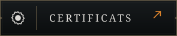</a>&nbsp;
  

  <a href="mailto:charles.lindecker@outlook.fr"><picture><source media="(max-width: 700px)" srcset="./assets/fr/end.mobile.svg"></picture></a>

  &nbsp;
  &nbsp;
  

  &nbsp;
  <a href="https://github.com/LINDECKER-Charles/PVZ-Fuzion-ConsolManager/blob/main/CONTRIBUTING.md">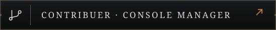</a>

  <a href="https://charles-lindecker.com"><picture><source media="(max-width: 700px)" srcset="./assets/fr/footer.mobile.svg"></picture></a>

  <picture><source media="(max-width: 700px)" srcset="./assets/fr/note-credits.mobile.svg"></picture>

