<!-- Generated by tools/build.mjs: edit tools/src/content.mjs, then run “npm run build” in tools/. -->

  <a href="./README.fr.md">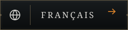</a>

  <a href="https://charles-lindecker.com"><picture><source media="(max-width: 700px)" srcset="./assets/en/hero.mobile.svg"></picture></a>

  &nbsp;
  &nbsp;
  

  <a href="https://www.linkedin.com/in/charles-lindecker/"><picture><source media="(max-width: 700px)" srcset="./assets/en/hunter.mobile.svg"></picture></a>

  <a href="https://charles-lindecker.com"><picture><source media="(max-width: 700px)" srcset="./assets/en/rules.mobile.svg"></picture></a>

  <a href="https://charles-lindecker.com"><picture><source media="(max-width: 700px)" srcset="./assets/en/sky.mobile.svg"></picture></a>

  <a href="https://bloodborne-legendary-run.com/en/sky"><picture><source media="(max-width: 700px)" srcset="./assets/en/flagship.mobile.svg"></picture></a>

  <a href="https://bloodborne-legendary-run.com/en/sky"><picture><source media="(max-width: 700px)" srcset="./assets/en/rituals.mobile.webp">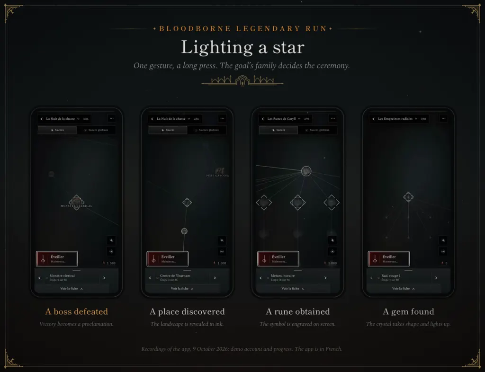</picture></a>

  &nbsp;
  

  <picture><source media="(max-width: 700px)" srcset="./assets/en/sep-equipe.mobile.svg"></picture>

  <a href="https://github.com/Teyliu/PVZF-Translation"><picture><source media="(max-width: 700px)" srcset="./assets/en/card-pvz.mobile.svg"></picture></a>

  <a href="https://github.com/Teyliu/PVZF-Translation">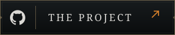</a>&nbsp;
  <a href="https://github.com/LINDECKER-Charles/PVZ-Fuzion-ConsolManager">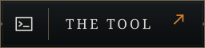</a>

  <picture><source media="(max-width: 700px)" srcset="./assets/en/sep-jeu.mobile.svg"></picture>

  <a href="https://github.com/LINDECKER-Charles/public-Omnicard/blob/main/docs/rules.md"><picture><source media="(max-width: 700px)" srcset="./assets/en/card-omnicard.mobile.svg"></picture></a>

  <a href="https://github.com/LINDECKER-Charles/public-Omnicard/blob/main/docs/rules.md">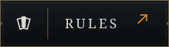</a>

  <a href="https://league-of-data-base.com/en/"><picture><source media="(max-width: 700px)" srcset="./assets/en/card-league.mobile.svg"></picture></a>

  &nbsp;
  <a href="https://github.com/LINDECKER-Charles/LeagueOfDataBaseFinal">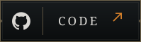</a>

  <picture><source media="(max-width: 700px)" srcset="./assets/en/sep-outils.mobile.svg"></picture>

  <a href="https://github.com/LINDECKER-Charles/gup"><picture><source media="(max-width: 700px)" srcset="./assets/en/card-gup.mobile.svg"></picture></a>

  &nbsp;
  <a href="https://www.npmjs.com/package/@charles_lindecker/gup">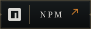</a>&nbsp;
  <a href="https://lindecker-charles.github.io/gup/">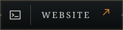</a>

  <a href="https://github.com/LINDECKER-Charles/App.GitHealth"><picture><source media="(max-width: 700px)" srcset="./assets/en/card-githealth.mobile.svg"></picture></a>

  

  <picture><source media="(max-width: 700px)" srcset="./assets/en/sep-ia.mobile.svg"></picture>

  <a href="https://charles-lindecker.com"><picture><source media="(max-width: 700px)" srcset="./assets/en/card-karl.mobile.svg"></picture></a>

  <a href="https://charles-lindecker.com"><picture><source media="(max-width: 700px)" srcset="./assets/en/card-sillage.mobile.svg"></picture></a>

  <a href="https://charles-lindecker.com"><picture><source media="(max-width: 700px)" srcset="./assets/en/card-relais.mobile.svg"></picture></a>

  <picture><source media="(max-width: 700px)" srcset="./assets/en/note-releve.mobile.svg"></picture>

  <a href="https://www.linkedin.com/in/charles-lindecker/"><picture><source media="(max-width: 700px)" srcset="./assets/en/path.mobile.svg"></picture></a>

  <a href="https://github.com/LINDECKER-Charles?tab=repositories"><picture><source media="(max-width: 700px)" srcset="./assets/en/arsenal.mobile.svg"></picture></a>

  <a href="https://www.freecodecamp.org/hexanti"><picture><source media="(max-width: 700px)" srcset="./assets/en/grimoire.mobile.svg"></picture></a>

  <a href="https://www.freecodecamp.org/hexanti">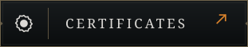</a>&nbsp;
  <a href="https://www.frontendmentor.io/profile/LINDECKER-Charles">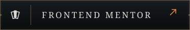</a>

  <a href="mailto:charles.lindecker@outlook.fr"><picture><source media="(max-width: 700px)" srcset="./assets/en/end.mobile.svg"></picture></a>

  &nbsp;
  &nbsp;
  

  <a href="https://github.com/LINDECKER-Charles/gup/blob/main/.github/CONTRIBUTING.md">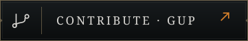</a>&nbsp;
  <a href="https://github.com/LINDECKER-Charles/PVZ-Fuzion-ConsolManager/blob/main/CONTRIBUTING.md">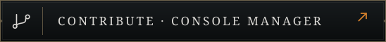</a>

  <a href="https://charles-lindecker.com"><picture><source media="(max-width: 700px)" srcset="./assets/en/footer.mobile.svg"></picture></a>

  <picture><source media="(max-width: 700px)" srcset="./assets/en/note-credits.mobile.svg"></picture>

